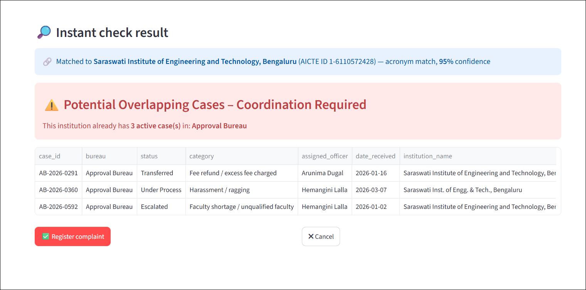
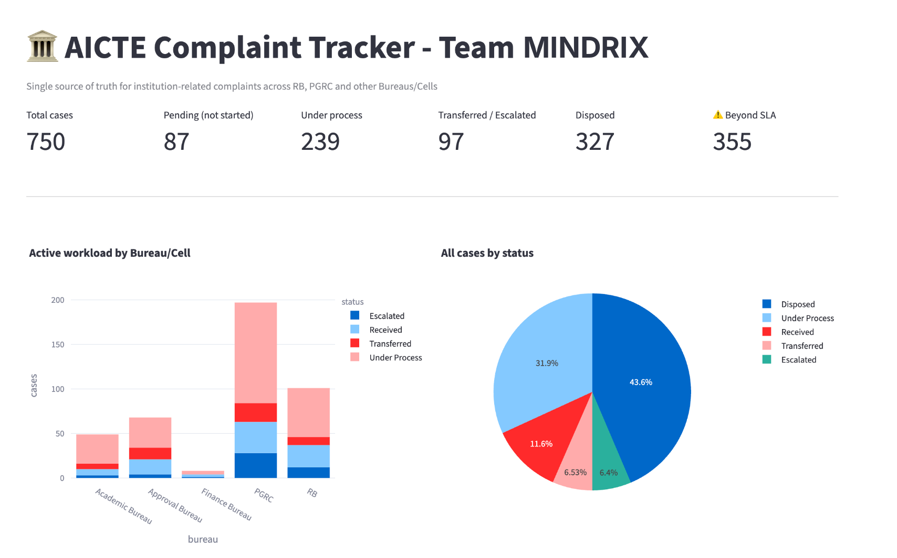
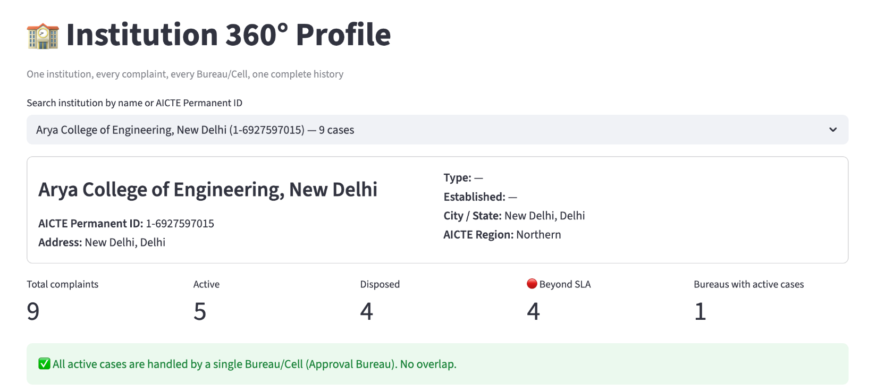

# Sangam – One College, One Screen, Every Complaint

**Smart India Hackathon 2026 · PS 26264 · AICTE (Regulation Bureau) · Theme: Smart Automation**
**Team MINDRIX · Team ID 199959 · G. L. Bajaj Institute of Technology and Management, Greater Noida**

AICTE receives complaints about technical institutions through several Bureaus and Cells, such as the
Regulation Bureau (RB) and the Public Grievance Redressal Cell (PGRC). The same college can be handled by
two departments at the same time, often under different spellings of its name, with neither knowing.

**Sangam** is a single-window dashboard that connects every complaint to the right institution and raises
**"Potential Overlapping Cases – Coordination Required"** the moment more than one Bureau is acting on the
same college, even when the name is abbreviated, misspelled, or the AICTE Permanent ID is missing.

> The system alerts. The officer decides.



## Features

| Area | What it does |
|---|---|
| **Overlap detection engine** | Links each complaint to the AICTE institution master by Permanent ID, acronym match (`SIET` → Saraswati Institute of Engineering and Technology) or fuzzy name match within the same city, then flags institutions active in 2+ Bureaus with a confidence score and the reasons |
| **New complaint check** | Before a complaint is registered, instantly shows the matched institution, overlapping cases in other Bureaus, and possible duplicates in the same Bureau |
| **Real-time dashboard** | Total, pending, under-process, transferred/escalated, disposed and beyond-SLA cases; Bureau workload; region and monthly trends |
| **Case register** | Search by case ID, institution name or AICTE ID; filter by Bureau, region, category, status and date range; full action history |
| **Take action** | Record an action, transfer, escalate or dispose a case, with remarks and supporting documents, all saved with officer and timestamp |
| **Case linking** | Officers confirm an overlap and link the related cases permanently |
| **Institution 360° profile** | Every complaint against one institution, across all Bureaus, on one timeline |
| **Alerts** | Cases approaching their deadline, overdue cases, escalations and cases with no action for 15+ days |
| **Reports** | Bureau-wise, region-wise and institution-wise reports, pending-case ageing, disposal rate, monthly/quarterly performance, overlap report; all downloadable as CSV |

## Results on our test data

The data in this repository is **synthetic**. It was generated to mimic real-world messiness
(abbreviations, acronyms, spelling variants, typos, missing AICTE IDs), with overlapping cases deliberately
hidden inside and a hidden answer key (`true_institution_id`) used only for testing.

| Metric | Result |
|---|---|
| Hidden cross-Bureau overlaps detected | **59 / 59** |
| False alarms | **6** (down from 107 after redesigning the engine to match against the institution master) |

Reproduce with `python test_overlap.py`.

## Screenshots

| Dashboard | Institution 360° profile |
|---|---|
|  |  |

## Run it locally

Requires Python 3.10+.

```bash
pip install -r requirements.txt
streamlit run app.py
```

Run the command from the repository folder, so the app can find the `data` folder. The app opens at
http://localhost:8501.

To regenerate the synthetic data from scratch:

```bash
python generate_data.py
python enrich_data.py
```

## Project structure

```
app.py                  Home dashboard
pages/
  1_Case_Register.py    Search, filters, case details and action history
  2_Overlap_Alerts.py   Cross-Bureau overlap alerts and case linking
  3_Alerts.py           Deadline, overdue, escalation and pending reminders
  4_Take_Action.py      Record, transfer, escalate or dispose a case
  5_Institution_Profile.py  Institution 360° profile
  6_Reports.py          Reports and analytics
  7_New_Complaint.py    Register a complaint with instant overlap and duplicate check
overlap.py              Matching and overlap/duplicate detection engine
store.py                All writes to the data files
config.py               Shared settings
generate_data.py        Creates the synthetic dataset
enrich_data.py          Adds addresses, complainants, descriptions and planted duplicates
test_overlap.py         Measures engine accuracy against the hidden answer key
data/                   Synthetic institutions, complaints and action history
```

## Tech stack

Python · Streamlit · Pandas · RapidFuzz · Plotly

**Production path:** PostgreSQL in place of CSV files (all writes already go through `store.py`), AICTE
single sign-on with role-based access per Bureau and Regional Office, API integration with the AICTE portal
and CPGRAMS, hosting on government cloud, and a learning layer trained on officers' confirm/reject decisions.

## Team MINDRIX

Prince Goel (Team Leader) · Prince Tomar · Vanya · Nihal Sachan · Nitin Kumar · Ankit Seth

G. L. Bajaj Institute of Technology and Management, Greater Noida
